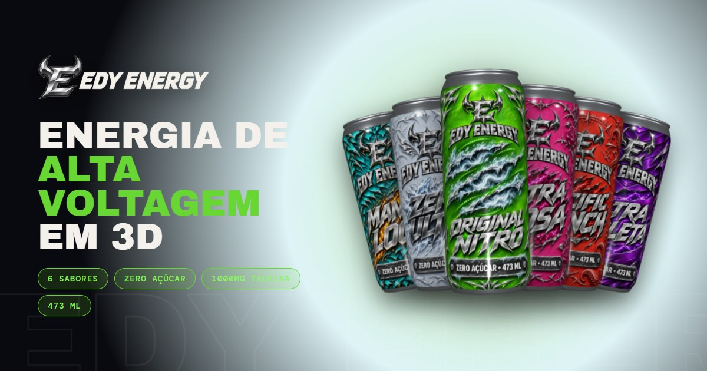
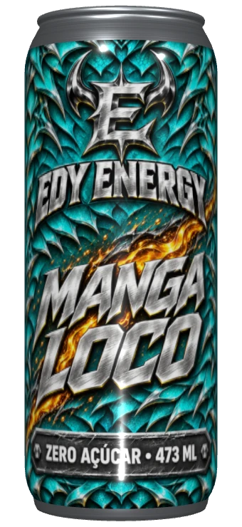
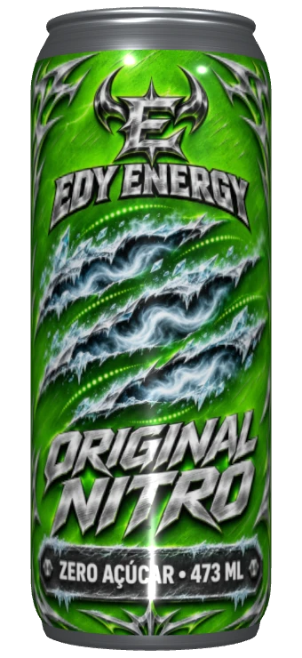
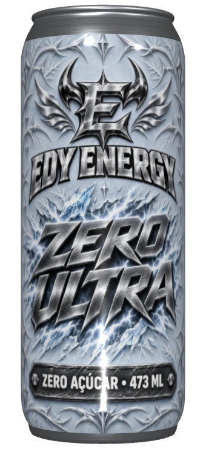
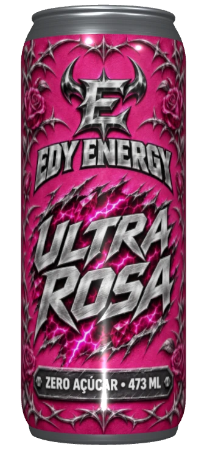
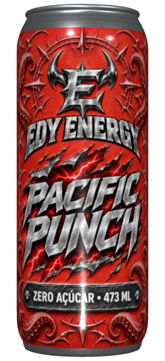
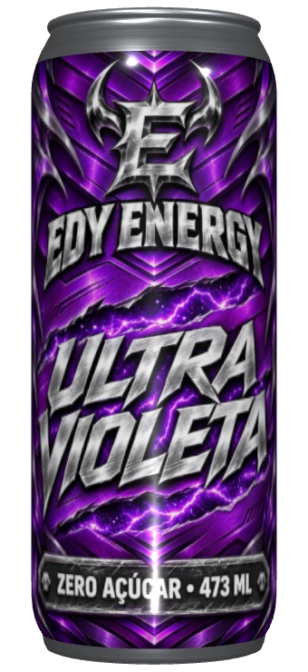

<p align="center">
  
</p>

# EDY ENERGY

Experiência web 3D para uma marca conceito de energético. Explore seis sabores em um carrossel interativo, acompanhe a lata entre as seções e monte um pack com as suas escolhas.

[**Abrir a demonstração**](https://edy-energy.edy-scanurl-family-worker.workers.dev/) · [Ver os três prelúdios](#três-prelúdios) · [Executar localmente](#executar-localmente)

## Sobre o projeto

O EDY ENERGY explora como uma mesma lata pode conduzir a navegação de uma vitrine inteira. Na abertura, ela faz parte de um carrossel com cores, tipografia e partículas próprias de cada sabor. Na rolagem, muda de posição e enquadramento para acompanhar a apresentação da fórmula e chegar à grade da loja.

A loja é demonstrativa. A seleção do pack, os preços, o carrinho e a confirmação de pedido funcionam no navegador, sem integração de pagamento ou envio de pedidos.

## O que você encontra

| Recurso | Como funciona |
| --- | --- |
| **Abertura cinematográfica** | Três prelúdios alternados entre visitas, com a opção **Pular intro**. |
| **Carrossel de sabores** | Arraste, toque ou use as setas do teclado para trocar de sabor. O autoplay pode ser pausado. |
| **Fórmula em movimento** | A rolagem leva a lata por etapas que apresentam os ingredientes da marca conceito. |
| **Vitrine interativa** | Veja as seis latas em cards interativos e adicione unidades ao carrinho de demonstração. |
| **Montador de pack** | Combine até seis latas. A composição visual e o valor exibido acompanham a seleção. |
| **Carrinho local** | Revise os itens e o total, limpe a seleção ou teste a confirmação do pedido. O navegador guarda o pack e o carrinho entre visitas. |

## Três prelúdios

| Prelúdio | O que aparece | Demo |
| --- | --- | --- |
| **Dark Voltage Forge** | Emblema cromado, arcos elétricos e um anel de interface sobre fundo escuro. | [Abrir versão A](https://edy-energy.edy-scanurl-family-worker.workers.dev/?intro=a) |
| **Turbo 6-Flavour Flash Roulette** | Cortes rápidos entre cores, nomes e recortes de ingredientes dos seis sabores. | [Abrir versão B](https://edy-energy.edy-scanurl-family-worker.workers.dev/?intro=b) |
| **3D Can Vortex Spin-Up** | Lata 3D em rotação, cercada por anéis de energia, até a entrada do carrossel. | [Abrir versão C](https://edy-energy.edy-scanurl-family-worker.workers.dev/?intro=c) |

Na prévia local, use `?intro=a`, `?intro=b` ou `?intro=c` para selecionar a abertura. Com a preferência de movimento reduzido ativa, a experiência pula o prelúdio.

## Coleção de sabores

| Manga Loco | Original Nitro | Zero Ultra |
| :---: | :---: | :---: |
|  |  |  |
| Turquesa | Verde elétrico | Prata |

| Ultra Rosa | Pacific Punch | Ultra Violeta |
| :---: | :---: | :---: |
|  |  |  |
| Rosa | Vermelho | Violeta |

## Motion e direção visual

- **Latas 3D.** Geometria procedural, materiais metálicos, iluminação de estúdio e texturas WebP específicas de cada sabor.
- **Troca de ambiente.** A revelação radial acompanha a mudança de cor, tipografia, rótulo e partículas do carrossel.
- **Transições por rolagem.** A lata em destaque muda de escala, posição e rotação conforme avança do carrossel para a fórmula e a vitrine.
- **Interações de compra.** A seleção do pack reorganiza as latas e a adição de itens usa uma animação em direção ao carrinho.
- **Áudio e movimento.** Efeitos sonoros sintetizados no navegador, controle de som e tratamento para `prefers-reduced-motion`.

## Tecnologias e arquitetura

| Tecnologia | Papel no projeto |
| --- | --- |
| **HTML, CSS e JavaScript** | Estrutura, layout responsivo, navegação, animações e lógica do carrinho. |
| **Three.js 0.160.0 e WebGL** | Cena compartilhada para as latas 3D e sua iluminação. |
| **Canvas 2D e Web Audio API** | Efeitos gráficos da abertura e sons de interação. |
| **WebP e fontes incorporadas** | Rótulos, imagens das latas, elementos gráficos e tipografia Archivo Black, Inter e DM Mono. |
| **Cloudflare Workers Static Assets** | Hospedagem estática e roteamento da página 404. |

O front-end está concentrado em [index.html](index.html) e funciona sem etapa de build. A prévia local também precisa de acesso à internet para carregar o Three.js pelo jsDelivr.

## Executar localmente

Use Git, Node.js 22.12 ou superior com npm e um navegador com suporte a WebGL para ver as latas em 3D. A prévia foi verificada com Wrangler 4.166.0.

```sh
git clone https://github.com/EDY075/edy-energy.git
cd edy-energy
npx wrangler dev --local
```

Abra o endereço indicado pelo Wrangler, normalmente [http://localhost:8787/](http://localhost:8787/). Uma rota inexistente abre a página 404 customizada, que também inclui uma simulação visual do estado 503.

Para publicar uma cópia na sua conta, ajuste o nome do Worker em `wrangler.jsonc`, autentique-se e execute a publicação. [Guia do Cloudflare Workers Static Assets](https://developers.cloudflare.com/workers/static-assets/get-started/).

```sh
npx wrangler login
npx wrangler deploy
```

## Estrutura do repositório

```text
edy-energy/
├── index.html                  # interface, dados, motion e cena 3D
├── 404.html                    # página 404 temática com modo visual 503
├── manifest.json               # nome, ícone e cores do app
├── wrangler.jsonc              # configuração do Cloudflare Workers Static Assets
├── .assetsignore               # exclusões da publicação estática
├── prompts-latas-edy-energy.md # referências de direção de arte para os rótulos
└── assets/                     # marca, banner, rótulos, latas e partículas
```

As variantes e as referências a texturas ficam no catálogo `FLAVORS` de [index.html](index.html). As artes aplicadas estão em [assets/](assets/) como `label-*.webp`; as propostas visuais estão na [documentação dos rótulos](prompts-latas-edy-energy.md).

## Créditos

Projeto de [Edmilson Gomes](https://github.com/EDY075).
